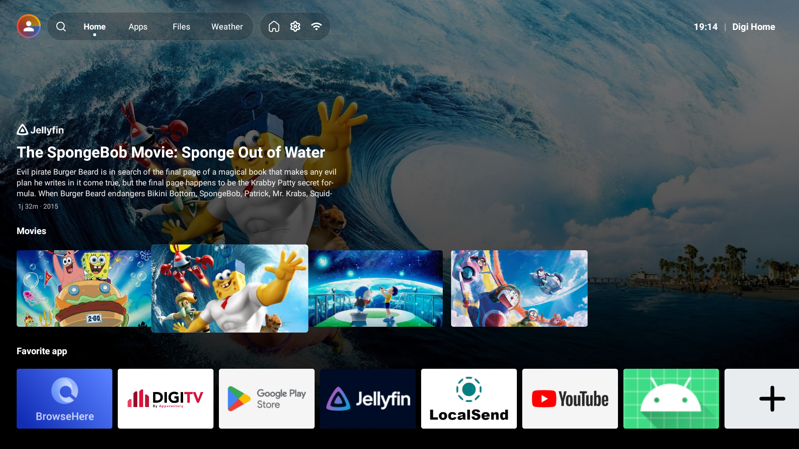
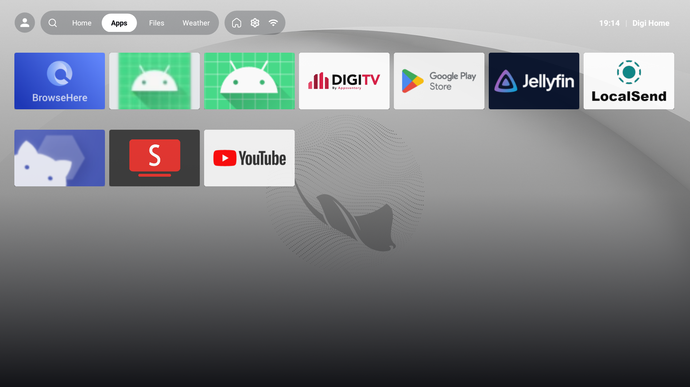
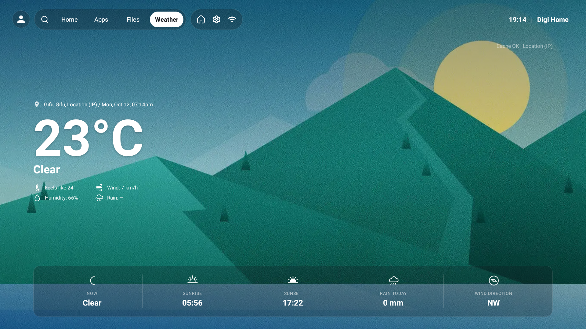
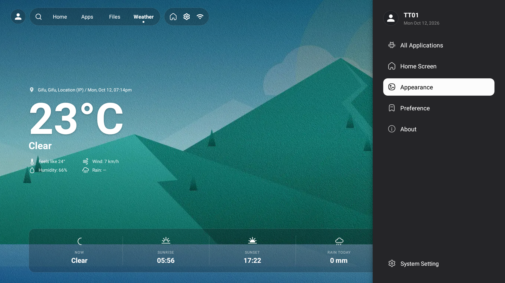

# Digi Home

Digi Home is a custom Android launcher and home-screen application for Android TV and Android devices. The project is built with Kotlin and AndroidX, and it combines a launcher-style home screen with app discovery, a weather tab, a file manager, and a settings shell for customizing the experience.


## Overview

The app is implemented as a single `MainActivity` launcher experience with multiple sections:

- Home screen with a hero/content carousel and a custom channel grid
- App launcher grid for installed applications
- File browser for local storage and Samba/SMB network shares
- Weather screen backed by Open-Meteo with device/IP location fallback
- Settings sidebar to configure home content, app favorites, appearance, navigation, and shortcut actions

The project is intended for Android devices that support launcher/home-screen behavior, including Leanback/TV-style setups. The manifest declares both standard launcher and Leanback launcher categories.

## Screenshots

<div align="center">
  
  
</div>
<div align="center">
  
  
</div>


---

## Verified features

The following features are directly implemented and reachable in the source tree:

- Launcher/Home shell with tab navigation: Home, Apps, Files, and Weather
- Search overlay and web-search behavior in the top bar
- Installed app listing, favorites, and app launching through `AppRepository`
- TV content carousel driven by Android TV channel data (`TvChannelRepository` and `Recommendation` models)
- Persistent home settings such as banner/carousel state, custom channel IDs, default tab, and navigation order
- Weather widget and weather tab using Open-Meteo and geolocation fallbacks
- File manager with local file browsing, filters, sorting, grid/list views, and Samba network connection setup
- Settings sidebar for selected content, app selection, wallpaper/theme preferences, shell shortcuts, and app settings
- Permission onboarding for location, TV listing access, and storage access where relevant

## Technology stack

- Kotlin 2.2.0
- Android Gradle Plugin 8.13.2
- Android compile SDK: 36
- Android target SDK: 36
- Android minimum SDK: 26
- AndroidX libraries, Material Components, TV Provider, SMBJ, and BouncyCastle

## Project structure

```text
.
├── app/
│   ├── src/main/
│   │   ├── AndroidManifest.xml
│   │   ├── java/com/appsventory/digiapps/launchpad4/
│   │   └── res/
│   └── build.gradle.kts
├── gradle/
├── build.gradle.kts
├── gradle.properties
├── gradlew
├── gradlew.bat
├── settings.gradle.kts
├── docs/
│   └── previews/
└── README.md
```

Key implementation areas include:

- `app/src/main/java/com/appsventory/digiapps/launchpad4/MainActivity.kt` — launcher shell, tab switching, home screen orchestration, and app lifecycle logic
- `app/src/main/java/com/appsventory/digiapps/launchpad4/data/AppRepository.kt` — installed app scanning and package metadata retrieval
- `app/src/main/java/com/appsventory/digiapps/launchpad4/data/WeatherRepository.kt` — weather fetching, location resolution, and cache logic
- `app/src/main/java/com/appsventory/digiapps/launchpad4/data/TvChannelRepository.kt` — Android TV channel metadata and recommendation retrieval
- `app/src/main/java/com/appsventory/digiapps/launchpad4/ui/files/FileManagerController.kt` — local and network file browsing logic
- `app/src/main/java/com/appsventory/digiapps/launchpad4/ui/settings/SettingsSidebarController.kt` — sidebar configuration and content management

## Requirements and environment

- Android Studio with an installed Android SDK
- Android SDK level compatible with `compileSdk = 36`
- JDK 23 configured for the Kotlin toolchain
- A supported device or emulator running Android 8.0+ (`minSdk = 26`)
- Network access for weather requests and optional external network shares
- Location permission and TV listing access may be required for weather and TV channel features to work as intended

## Build and run

This project was verified via a local debug build:

```bash
./gradlew assembleDebug
```

The build completed successfully in this environment.

If you want to install to a connected Android device, use the Android build tools normally available from the SDK after the debug APK is generated.

## Usage

1. Launch the app from the device launcher.
2. Review the permission onboarding dialog if it appears.
3. Use the top bar to navigate between Home, Apps, Files, and Weather.
4. Open the settings button to adjust the launcher, content carousel, wallpaper, navigation order, weather widget, or app shortcuts.
5. Use the Files tab to browse local storage or add Samba shares.
6. Select a TV channel in the settings for the Home content carousel if TV provider data is available on the device.

## Configuration notes

Settings are persisted in the app's shared preferences file (`digi_home`), and the app stores user preferences for:

- favorite apps
- carousel and custom channel settings
- wallpaper and theme preferences
- default tab and tab order
- file manager view/sort settings
- Samba share entries
- shell shortcut configuration

## Known limitations and constraints

The repository does not include a unit test suite or CI workflow, and there is no license file in the repository root.

The app's behavior depends on real device capabilities and permissions:

- Weather updates require location permission or a valid IP-based fallback.
- TV content recommendations depend on installed TV provider channels and Android TV metadata.
- Samba browsing requires valid network share metadata and connectivity.
- Some settings and permissions are only useful on devices that expose the corresponding Android APIs.

## Development notes

This repository is currently a single Android project without a separate backend or service layer. Most of the logic remains inside the Android app module and is organized around feature-specific repository and controller classes.

---

**Made with AI [♥] by ~~Mulya Saputra~~ & ICK Network Team**